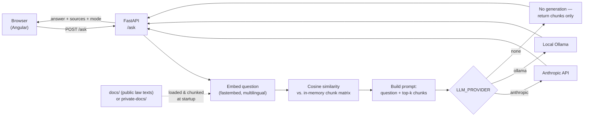

# gesetze-chat

A retrieval-augmented question-answering demo for German everyday law (tenancy, employment, leave), with a Python/FastAPI backend and an Angular frontend.

> **Portfolio demo — general information from public law texts, not legal advice.**


## What it does

You ask a question in German or English (e.g. *"Wann darf der Vermieter kündigen?"*). The backend embeds the question, finds the most relevant passages from the official law texts in [`docs/`](docs/), and either returns those passages directly ("retrieval only") or asks an LLM to answer strictly from that retrieved context, citing the section it used (e.g. "§ 573 BGB").



At startup the API reads every `.md`/`.txt`/`.pdf` file in `DOCS_DIR`, splits it into chunks (by `§`/"Absatz" boundaries where possible, so each chunk keeps its section heading as metadata), embeds all chunks once, and keeps them in memory as a NumPy matrix. No vector database, no LangChain — just a list of chunks and a cosine-similarity search, which is all a demo-sized corpus needs.

## Tech stack

- **Backend:** Python 3.11+, FastAPI, Pydantic, [fastembed](https://github.com/qdrant/fastembed) (local multilingual embeddings), NumPy, pypdf, pytest.
- **Frontend:** Angular (standalone components, no NgModules), plain SCSS, Vitest.
- **LLM (optional):** Anthropic API, or a local Ollama model — or no LLM at all.

## Privacy

- In **anthropic** mode, the retrieved text chunks (not whole documents) are sent to the Anthropic API as part of the prompt.
- In **ollama** mode, generation happens against a model running on your own machine — nothing leaves it.
- In **none** mode, nothing is sent anywhere; the API only returns the retrieved passages.
- For your own documents, use the **ollama** or **none** provider and point `DOCS_DIR` at `private-docs/`. That folder is listed in `.gitignore` — never commit it.

## Prerequisites

- Python 3.11+
- Node.js 22.x and npm 11.x (any recent Node 20/22 LTS should work)
- Optional: a running [Ollama](https://ollama.com) instance, or an Anthropic API key

## Installation and running

### macOS / Linux

```bash
# Backend
cd api
python3 -m venv .venv
source .venv/bin/activate
pip install -r requirements.txt
cp .env.example .env
uvicorn app.main:app --reload --port 8000
```

```bash
# Frontend (in a new terminal)
cd web
npm install
npm start
```

Open http://localhost:4200.

### Windows (PowerShell)

```powershell
# Backend
cd api
python -m venv .venv
.venv\Scripts\Activate.ps1
pip install -r requirements.txt
Copy-Item .env.example .env
uvicorn app.main:app --reload --port 8000
```

```powershell
# Frontend (in a new terminal)
cd web
npm install
npm start
```

Open http://localhost:4200.

## The three modes

Set `LLM_PROVIDER` in `api/.env`:

| Mode | `LLM_PROVIDER` | What you need | What happens |
|---|---|---|---|
| Retrieval only | `none` (default) | nothing | returns the top matching passages, no generated answer |
| Anthropic | `anthropic` | `ANTHROPIC_API_KEY` | retrieved chunks + question sent to the Anthropic API for a generated, cited answer |
| Local (Ollama) | `ollama` | Ollama running locally with `OLLAMA_MODEL` pulled | same as above, but fully local |

To query your own documents instead of the demo law texts, set `DOCS_DIR=../private-docs` in `api/.env` and drop your `.md`/`.txt`/`.pdf` files into `private-docs/`.

## Tests and evaluation

```bash
# Backend tests (no network calls)
cd api
source .venv/bin/activate   # .venv\Scripts\Activate.ps1 on Windows
pytest

# Retrieval evaluation (no API key needed)
python eval/run_eval.py
```

```bash
# Frontend tests
cd web
npm test
```

The evaluation runs 20 hand-verified questions (German and English) against the real law texts and checks whether the expected section appears in the top 3 retrieved chunks. Current result: **11/20 = 55% hit rate @3**. See [`api/eval/questions.json`](api/eval/questions.json) for the questions and [`api/eval/run_eval.py`](api/eval/run_eval.py) for the script.

## Example questions to try

- *Wann darf der Vermieter kündigen?*
- *Wie viele Werktage Urlaub stehen einem Arbeitnehmer mindestens pro Jahr zu?*
- *How is an employee's vacation pay calculated?*
- *Under what conditions is a dismissal considered socially unjustified?*
- *Wie lange muss der Arbeitgeber im Krankheitsfall das Arbeitsentgelt fortzahlen?*

## Design decisions and trade-offs

- **In-memory vectors, no vector database:** the demo corpus is a few hundred chunks. A NumPy matrix and cosine similarity are simple to read, debug and explain, and are fast enough at this scale. A real production corpus would need a proper vector index (see below).
- **Local multilingual embeddings (fastembed):** the corpus and questions are German; English-only embedding models rank German text poorly. `paraphrase-multilingual-MiniLM-L12-v2` handles both languages and needs no API key, so retrieval always works even with `LLM_PROVIDER=none`.
- **No LangChain:** the whole pipeline (load → chunk → embed → retrieve → prompt) is under 200 lines of plain Python. That's deliberately a worse trade for a large production system and a better one for a project meant to be read and explained line by line.
- **Chunking by section (§) boundaries:** splitting on legal section/paragraph boundaries instead of raw character windows keeps each chunk legally coherent and lets every chunk carry its section number as metadata, which is what makes citations (e.g. "§ 573 BGB") possible.

## Known limitations and what I'd improve next

- Retrieval hit rate @3 is 55% — good enough to demonstrate the pipeline, not production quality. A cross-encoder reranker on top of the initial cosine search would likely help most.
- The in-memory NumPy index rebuilds on every restart and doesn't scale past a few thousand chunks; a real deployment would use pgvector or a dedicated vector store.
- No streaming: the Anthropic/Ollama call blocks until the full answer is generated.
- No Docker setup or CI pipeline yet — both would make this easier to run and to trust.
- No authentication/rate limiting, since this is a local demo.

## Recording the demo

1. Start the backend (`LLM_PROVIDER=none` is fine, or `ollama` for a generated answer) and the frontend as above.
2. Open http://localhost:4200 in a clean browser window sized around 1280×800.
3. Use a screen recorder (e.g. macOS `Cmd+Shift+5`, or [Kap](https://getkap.co/)) and start recording.
4. Type one of the example questions above, submit, and let the answer and sources render; expand one source to show the chunk text.
5. Stop recording, trim, convert to GIF (e.g. `ffmpeg -i demo.mov -vf "fps=10,scale=960:-1" assets/demo.gif`), and drop it into `assets/demo.gif`.
